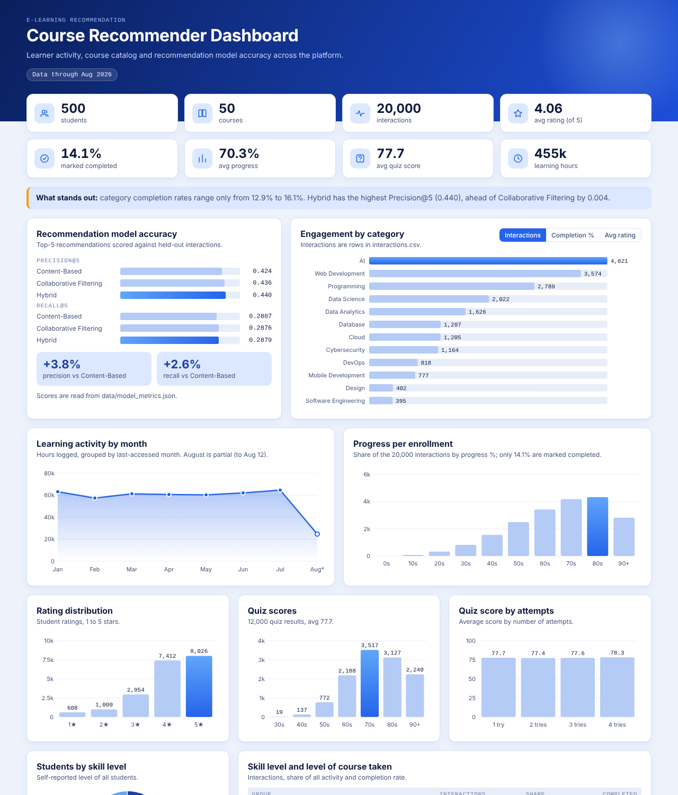
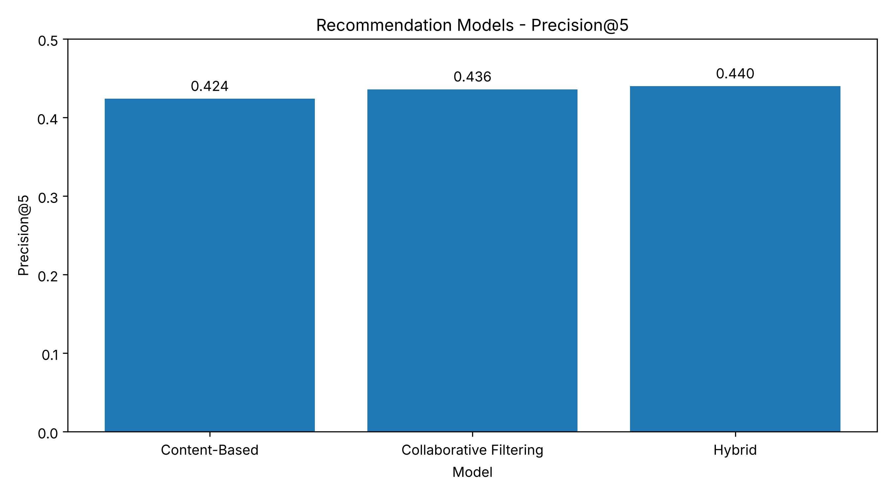
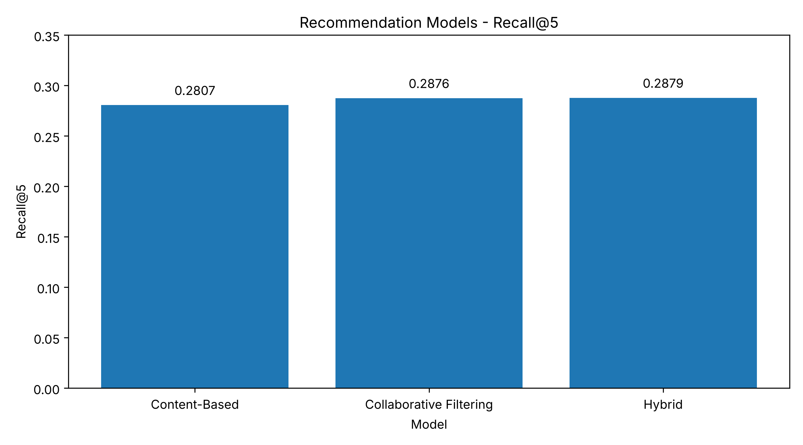

## INTELLIGENT_RECOMMENDATION_SYSTEM_FOR_E-LEARNING_PLATFORM
An AI-powered E-Learning Recommendation System that provides personalized course suggestions using Content-Based, Collaborative, and Hybrid Filtering. Features include student login, course search, explainable recommendations, learning progress tracking, and interactive analytics dashboards using Python and Streamlit.

# 🎓 Intelligent E-Learning Recommendation System

An AI-powered course recommendation system that provides personalized learning suggestions to students using **Content-Based Filtering, Collaborative Filtering, and Hybrid Recommendation techniques**.

The project includes a Streamlit student application and a separate interactive analytics dashboard to help students discover relevant courses and track their learning progress.



---

## 📌 Table of Contents

- [Project Overview](#-project-overview)
- [Objectives](#-objectives)
- [Key Features](#-key-features)
- [Recommendation Techniques](#-recommendation-techniques)
- [System Architecture](#-system-architecture)
- [Technologies Used](#-technologies-used)
- [Project Structure](#-project-structure)
- [Dataset Description](#-dataset-description)
- [Model Performance](#-model-performance)
- [Installation and Setup](#-installation-and-setup)
- [How to Run](#-how-to-run)
- [Demo Login](#-demo-login)
- [Screenshots](#-screenshots)
- [Future Enhancements](#-future-enhancements)
- [Contributing](#-contributing)
- [License](#-license)

---

## 📖 Project Overview

Online learning platforms provide thousands of courses across different subjects and skill levels. However, students often struggle to identify courses that match their interests, learning history, and current knowledge.

The **Intelligent E-Learning Recommendation System** addresses this problem by recommending relevant courses based on student profiles, course information, and learning interactions.

The system uses a hybrid recommendation approach that combines content-based filtering and collaborative filtering to generate personalized course recommendations.

It also provides recommendation explanations, course searching, enrollment, progress tracking, and analytics to improve the overall learning experience.

---

## 🎯 Objectives

1. Develop an intelligent course recommendation system for e-learning platforms.
2. Provide personalized course suggestions based on student interests and learning patterns.
3. Implement Content-Based Filtering and Collaborative Filtering techniques.
4. Combine recommendation techniques using a Hybrid Recommendation Model.
5. Explain why a particular course is recommended to a student.
6. Track student enrollment and course completion progress.
7. Evaluate recommendation performance using Precision@5 and Recall@5.
8. Provide an interactive dashboard for student learning and platform analytics.

---

## 🚀 Key Features

### 1. Student Login
- Student login using Student ID and password.
- Student records are validated using the student dataset.
- Personalized dashboard for each student.

### 2. Personalized Course Recommendations
- Recommends courses based on student information and learning interactions.
- Uses a hybrid recommendation algorithm.
- Displays the top recommended courses with recommendation scores.

### 3. Explainable Recommendations
- Provides understandable explanations for recommended courses.
- Helps students understand why a course matches their learning profile.

### 4. Course Search and Filtering
- Search courses by name or keyword.
- Filter courses by category.
- Filter courses by difficulty level.
- View course descriptions and ratings.

### 5. Course Enrollment
- Students can start recommended or searched courses.
- Enrollment information is stored in `data/enrollments.csv`.
- Duplicate enrollments are prevented.

### 6. Learning Progress Tracking
- Track progress for enrolled courses.
- Update course progress.
- Automatically identify completed courses when progress reaches 100%.
- Store progress updates in the enrollment dataset.

### 7. Analytics Dashboard
The separate analytics dashboard provides visual insights into:
- Student learning activity.
- Course engagement.
- Learning hours.
- Course progress.
- Course ratings.
- Quiz performance.
- Student learning profiles.
- Recommendation model performance.

### 8. Model Evaluation
- Compare Content-Based Filtering.
- Compare Collaborative Filtering.
- Compare Hybrid Recommendation.
- Evaluate using Precision@5 and Recall@5.

---

## 🧠 Recommendation Techniques

The system implements three recommendation approaches.

### 1. Content-Based Filtering

Content-Based Filtering recommends courses by identifying similarities between course information and student preferences.

The project uses **TF-IDF (Term Frequency-Inverse Document Frequency)** to represent course text and calculate similarity.

It helps recommend courses related to a student's interests and previously studied subjects.

### 2. Collaborative Filtering

Collaborative Filtering identifies similarities between students based on their learning interactions.

It uses patterns from similar students to recommend courses that a student may find useful.

For example, if students with similar learning patterns have completed a particular course, that course may be recommended to another student with similar preferences.

### 3. Hybrid Recommendation System

The Hybrid Recommendation System combines Content-Based Filtering and Collaborative Filtering to generate recommendations.

It uses multiple recommendation signals to provide more relevant course suggestions.

**The hybrid model achieved the highest Precision@5 in the recorded evaluation results.**

---

## 🏗️ System Architecture

The overall workflow of the system is:

```text
              Student Login
                    |
                    v
             Student Profile
                    |
                    v
             Student Dataset
                    |
                    v
         Recommendation Engine
                    |
          +---------+---------+
          |                   |
          v                   v
    Content-Based       Collaborative
      Filtering           Filtering
          |                   |
          +---------+---------+
                    |
                    v
           Hybrid Recommendation
                    |
                    v
          Personalized Courses
                    |
          +---------+---------+
          |                   |
          v                   v
     Explanation          Course Search
          |                   |
          +---------+---------+
                    |
                    v
            Course Enrollment
                    |
                    v
          Learning Progress Tracking
                    |
                    v
              Analytics
```

---

## 🛠️ Technologies Used

| Technology | Purpose |
|---|---|
| Python | Main programming language |
| Streamlit | Interactive student application |
| Pandas | Data processing and manipulation |
| NumPy | Numerical operations |
| Scikit-learn | TF-IDF and machine learning |
| Matplotlib | Model evaluation charts |
| HTML | Analytics dashboard structure |
| CSS | Dashboard styling |
| JavaScript | Dashboard interactions |
| Jupyter Notebook | Exploratory Data Analysis |
| Git and GitHub | Version control and project hosting |

---

## 📂 Project Structure

```text
E-Learning-Recommendation-System/
│
├── app/
│   └── app.py
│
├── dashboard/
│   ├── build_dashboard.py
│   ├── index.html
│   └── template.html
│
├── data/
│   ├── students.csv
│   ├── student_features.csv
│   ├── courses.csv
│   ├── interactions.csv
│   ├── learning_history.csv
│   ├── quiz_results.csv
│   ├── enrollments.csv
│   └── model_metrics.json
│
├── recommendation/
│   ├── content_based.py
│   ├── collaborative.py
│   ├── hybrid.py
│   ├── explanation.py
│   ├── evaluation.py
│   └── evaluation_chart.py
│
├── notebooks/
│   └── 01_EDA.ipynb
│
├── docs/
│   ├── dashboard.png
│   ├── precision_at_5.png
│   └── recall_at_5.png
│
├── README.md
├── requirements.txt
└── .gitignore
```

---

## 📊 Dataset Description

The project uses multiple CSV files to represent student information, course information, and learning activities.

| Dataset | Description |
|---|---|
| `students.csv` | Student information and identifiers |
| `student_features.csv` | Student learning features and profiles |
| `courses.csv` | Course details, categories, levels, and ratings |
| `interactions.csv` | Student-course interaction records |
| `learning_history.csv` | Student learning history |
| `quiz_results.csv` | Student quiz performance |
| `enrollments.csv` | Course enrollment and progress records |
| `model_metrics.json` | Recommendation evaluation metrics |

**Note:** The supplied datasets appear to be synthetic/sample data and should not be interpreted as real student records.

---

## 📈 Model Performance

The recommendation models were evaluated using **Precision@5** and **Recall@5**.

### Evaluation Results

| Recommendation Model | Precision@5 | Recall@5 |
|---|---:|---:|
| Content-Based Filtering | 0.424 | 0.2807 |
| Collaborative Filtering | 0.436 | 0.2876 |
| **Hybrid Recommendation** | **0.440** | **0.2879** |

### Precision@5 Comparison



### Recall@5 Comparison



### Evaluation Conclusion

The Hybrid Recommendation Model achieved the highest recorded results:

- **Precision@5:** 0.440
- **Recall@5:** 0.2879

Based on these evaluation results, the Hybrid Recommendation Model performed best among the three evaluated approaches.

To reproduce the evaluation, run:

```bash
python recommendation/evaluation.py
```

---

## ⚙️ Installation and Setup

Follow these steps to run the project locally.

### Step 1: Clone the Repository

```bash
git clone https://github.com/YOUR-USERNAME/E-Learning-Recommendation-System.git
```

### Step 2: Open the Project Folder

```bash
cd E-Learning-Recommendation-System
```

### Step 3: Create a Virtual Environment

```bash
python -m venv venv
```

Activate it on Windows:

```bash
venv\Scripts\activate
```

Activate it on macOS/Linux:

```bash
source venv/bin/activate
```

### Step 4: Install Dependencies

```bash
pip install -r requirements.txt
```

---

## ▶️ How to Run

### Run the Streamlit Student Application

Execute:

```bash
streamlit run app/app.py
```

The application will open in your browser.

If it does not open automatically, visit:

```text
http://localhost:8501
```

### Generate the Analytics Dashboard

To regenerate the analytics dashboard using the available datasets, execute:

```bash
python dashboard/build_dashboard.py
```

### Open the Standalone Analytics Dashboard

Open the following file in your browser:

```text
dashboard/index.html
```

---

## 🔐 Demo Login

For demonstration purposes, the application uses:

| Field | Value |
|---|---|
| Student ID | STU0001 |
| Password | 1234 |

You can also use another Student ID available in `data/students.csv`.

**Security Note:** The password is hardcoded for demonstration purposes. A production application should use secure authentication and password hashing.

---

## 🖼️ Screenshots

### Student Dashboard

## Dashboard Preview


### Model Performance

### Precision@5 Comparison


### Recall@5 Comparison


---

## 🔮 Future Enhancements

The following improvements can be considered in future versions:

- Implement secure student authentication.
- Add more advanced recommendation algorithms.
- Integrate deep learning-based recommendation models.
- Add real-time learning activity tracking.
- Improve recommendations using student feedback.
- Develop an administrator dashboard.
- Deploy the application using Streamlit Community Cloud or another cloud platform.
- Add more detailed recommendation explanations.
- Support additional learning resources such as videos, quizzes, and learning paths.

---

## 🤝 Contributing

Contributions, suggestions, and improvements are welcome.

To contribute:

1. Fork the repository.
2. Create a new branch.
3. Make your changes.
4. Commit your changes.
5. Submit a Pull Request.

---

## 📜 License

This project is intended for educational and learning purposes.

Add an appropriate open-source license, such as the MIT License, if you want others to reuse and modify the code under its terms.

---

## 👨‍💻 Project Information

**Project Name:** Intelligent Recommendation System for E-Learning Platforms

**Domain:** Artificial Intelligence and Machine Learning

**Project Type:** Machine Learning / Recommendation System

**Application:** Personalized Online Learning

**Primary Model:** Hybrid Recommendation System

---

⭐ If you find this project interesting, consider giving the repository a star!

